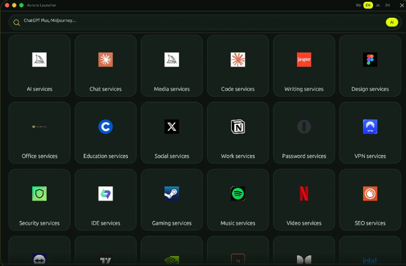

# AdGuard VPN Free 2026 — own protocol plus ad blocking on Windows

> **AdGuard VPN is paid everywhere. In our Aivora launcher the same paid Pro version is free.**
>
> Official site / app store = paid Pro subscription. Aivora launcher = that paid Pro product, free on Windows 10 / 11.

**Keywords:** AdGuard vpn · AdGuard vpn free · AdGuard vpn windows · AdGuard protocol · ad blocking VPN Windows 10 11 · paid AdGuard vpn free through launcher · Aivora Programs

Windows 10 / 11 · AdGuard VPN Pro · VPN services

Orange button → aivoraprograms.com → launcher → **Activate** **AdGuard VPN**. You get the **paid Pro** VPN **for free in our launcher**. No `AdGuardVPN.exe` in this repo.

## What AdGuard VPN is

AdGuard VPN is the paid tunnel from the AdGuard team. The live Aivora card is **Pro**: their **own protocol** (not a public WireGuard-only stack), **integrated ad blocking**, **65+ locations**. This is the VPN product, not AdGuard Browser or AdGuard for Windows DNS.

The protocol is why this page is not a Mullvad or Hotspot Shield clone. AdGuard ships a custom transport plus a blocker in the same Windows session. Locations are 65+, not a 6000-server mesh — use it when you want ads filtered on the tunnel, not when you need Double VPN.

**AdGuard VPN is paid everywhere else.** Official Pro is a subscription. In **our Aivora launcher** that same paid Pro is **free** on Windows 10 / 11. No AdGuard account. No card.

## Own protocol and the blocker

The exclusive protocol is AdGuard’s answer to networks that fingerprint OpenVPN or WireGuard. Ad blocking on this SKU is in the VPN path, not only as a browser extension. If a site breaks, disable the filter first, keep the tunnel. 65+ locations is the Aivora listing — pick the closest one after **Activate**.

## Who this Windows page is for

Searches: **AdGuard vpn**, **AdGuard vpn windows**, **AdGuard vpn free**, expecting **paid Pro** (protocol + blocker), not the limited free AdGuard VPN minutes. Typical cases: ads on hotel Wi-Fi, a protocol that is not stock WireGuard, Windows 10 / 11 laptop.

R.O.B.E.R.T. is Windscribe. Hydra is Hotspot Shield. This landing stays on AdGuard’s protocol.

## What the Pro card includes

| Feature | Official AdGuard VPN | In our Aivora launcher |
|---------|----------------------|------------------------|
| Price | Paid Pro subscription | **Free** (same paid Pro) |
| Exclusive protocol | Pro plan | Same Pro, free here |
| Integrated ad blocking | Pro plan | Same Pro, free here |
| 65+ locations | Pro plan | Same Pro, free here |
| Windows 10 / 11 client | Pro plan | Same Pro, free here |

## How to open paid AdGuard VPN on Windows

1. Open [https://aivoraprograms.com/](https://aivoraprograms.com/)
2. Download **Aivora Launcher**
3. Install on Windows 10 or Windows 11 (64-bit)
4. Open **VPN services**
5. Find **AdGuard VPN** and press **Activate**

Paid AdGuard VPN Pro — **free in our launcher**, paid on adguard.com.

## Search queries

- **AdGuard vpn**
- **AdGuard vpn free**
- **AdGuard vpn windows**
- **AdGuard Windows 10**
- **AdGuard Windows 11**
- **paid AdGuard vpn free through launcher**

## Screenshots

Launcher hub — **VPN services** → **AdGuard VPN**:

## FAQ

**Where is the download?**  
[https://aivoraprograms.com/](https://aivoraprograms.com/)

**Is AdGuard VPN paid or free?**  
Paid everywhere (official Pro). **Free in our Aivora launcher** — same paid Pro, not the official free-minute SKU.

**Do I need an AdGuard login?**  
No. **Activate** on the tile.

---

## На русском

# AdGuard VPN бесплатно 2026 — свой протокол и блокировка рекламы на Windows

> **Везде AdGuard VPN платный. В нашем лаунчере Aivora та же платная версия Pro — бесплатно.**
>
> Официальный сайт / магазин = платная подписка Pro. Лаунчер Aivora = этот же платный Pro, бесплатно на Windows 10 / 11.

**Ключевые слова:** AdGuard vpn · AdGuard vpn бесплатно · AdGuard vpn windows · протокол AdGuard · VPN с блокировкой рекламы Windows 10 11 · платный AdGuard vpn бесплатно через лаунчер · Aivora Programs

Оранжевая кнопка — главная Aivora. Лаунчер → **VPN-сервисы** → **AdGuard VPN** → **Активировать**. Это **платный Pro**, у нас в лаунчере **бесплатно**.

AdGuard VPN — туннель команды AdGuard. На карточке Aivora **Pro**: **свой протокол**, **блокировка рекламы**, **65+ локаций**. Это VPN, не AdGuard Browser.

**AdGuard VPN везде платный.** Официально подписка Pro. **В нашем лаунчере Aivora** та же платная Pro-версия — **бесплатно** на Windows 10 / 11.

Как открыть: [https://aivoraprograms.com/](https://aivoraprograms.com/) → лаунчер → **VPN-сервисы** → **AdGuard VPN** → **Активировать**.

AdGuard — товарный знак Adguard Software Ltd. Страница описывает доступ через Aivora Programs.

[https://aivoraprograms.com](https://aivoraprograms.com/) · hello@aivora.app

#windows11 #windows10 #vpn #adguard #aivora

---

*AdGuard vpn · AdGuard vpn free · AdGuard vpn windows · paid AdGuard vpn free through launcher · Aivora Programs · https://aivoraprograms.com/programs/adguard-vpn/*
